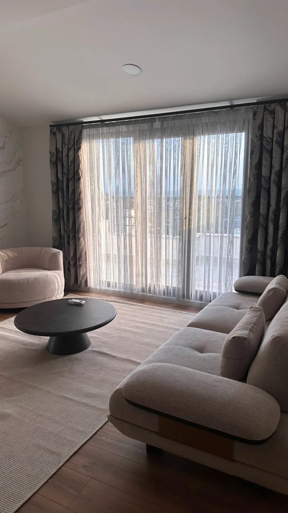
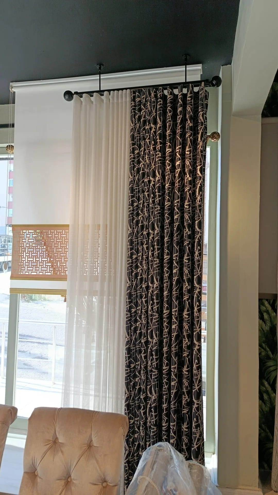
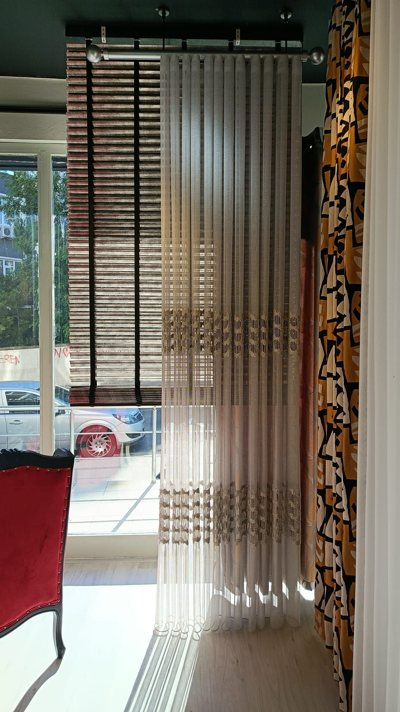

<div align="center">



<p>
  <a href="https://kilicarslanperdetasarim.vercel.app/"></a>
  
  
  
</p>

<p><em>A modern, premium and mobile-first showcase site for a local curtain and interior design atelier.<br>
Built to make a neighbourhood craft business look and feel like a brand.</em></p>

<a href="https://kilicarslanperdetasarim.vercel.app/"></a>

</div>


## What it is

Kılıçarslan Perde & Tasarım makes and installs curtains, blinds and tulle. Most of their customers find them on a phone, so the site is designed for one thumb first: a calm hero, the curtain models with clear descriptions, a gallery of finished work and a one-tap way to get in touch.


## What's on the site

| | |
|---|---|
| **Hero** | A slow, fabric-like motion intro with the atelier's mark. |
| **Models** | Every curtain and blind type, with materials, uses and photos (`/modeller`). |
| **Past work** | A gallery of finished installations (`/yapilan-isler`). |
| **Guide** | Practical advice on choosing fabric, measuring and care. |
| **Services** | Measuring, sewing, installation and repair. |
| **Contact** | Call, WhatsApp and directions in one tap. |
| **Search ready** | Open Graph images, `robots.txt` and a sitemap generated by the app. |

<table>
  <tr>
    <td width="33%"></td>
    <td width="33%"></td>
    <td width="33%"></td>
  </tr>
</table>


## Türkçe özet

**Kılıçarslan Perde & Tasarım**, yerel bir perde ve iç mekân tasarım atölyesi için hazırlanmış modern, premium ve mobil öncelikli bir vitrin sitesi. Perde ve stor modelleri, yapılan işlerin galerisi, kumaş seçimi ve ölçü alma rehberi, hizmetler ve tek dokunuşla arama/WhatsApp iletişimi içeriyor. Amaç, mahalle ölçeğindeki bir zanaat işletmesini bir marka gibi sunmak.


## Development

```sh
cd kilicarslanperdetasarim
npm install
npm run dev      # http://localhost:3000
npm run build
```

```
kilicarslanperdetasarim/
  src/app/          home, /modeller, /yapilan-isler, OG image, robots, sitemap
  src/components/   hero, products, gallery, sections, motion
  src/data/         business info, products, services, gallery, guide
  public/images/    brand, products and gallery photos
```

<div align="center">
<br>
<a href="https://github.com/kutluhangil"></a>
<sub>Made for a local atelier · photos of the atelier's own work.</sub>
</div>
