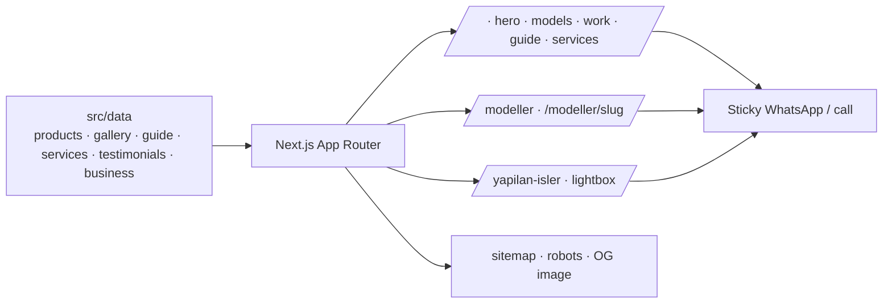

<div align="center">


<p>
  <a href="https://kilicarslanperdetasarim.vercel.app"></a>
  
  
  
</p>

<p><em>A premium, mobile-first showcase for Kılıçarslan Perde & Tasarım, a local curtain and interior atelier:<br>
ten curtain models, a gallery of finished rooms, a buying guide and contact one tap away.</em></p>

</div>


## The idea

A neighbourhood curtain workshop gets most of its customers from a phone: someone sees a finished room, wants the same, and sends a WhatsApp message. The site is built for exactly that path. It shows the models and real finished work in a way that feels like a premium brand, answers the questions people ask before buying, and keeps WhatsApp and call buttons in reach on every screen.

> **Contact never scrolls away.** On phones a sticky bar holds WhatsApp and call; on desktop a floating button does the same. Every page is a step toward a message, not a dead end.


## Features

| | |
|---|---|
| **Ten models** | Roller (stor), pleated (plise), wooden and metal venetian blinds, rustic, zebra, decorative rails, sheer (tül), drapes (fon) and office screen blinds, each with its own page and photo gallery. |
| **Finished work** | A gallery of completed rooms with a full-screen lightbox. |
| **Buying guide** | Which curtain for which room, how long curtains last, how to care for them, with links to the models and services. |
| **Services** | Washing and alterations, and curtain rail installation. |
| **Testimonials** | Short notes from customers. |
| **Contact** | A sticky mobile bar and a floating desktop button for WhatsApp and phone. |
| **Motion** | Framer Motion reveals and transitions tuned for phones. |
| **SEO** | Metadata, a generated Open Graph image, `sitemap.ts` and `robots.ts`. |
| **Optimised images** | 180+ product, gallery and brand images served through `next/image`. |


## How it fits together



| Route | Page |
|---|---|
| `/` | Home: hero, featured models, finished work, guide, services, testimonials |
| `/modeller` · `/modeller/[slug]` | All models and one model with its gallery |
| `/yapilan-isler` | Finished work |


## Türkçe özet

**Kılıçarslan Perde & Tasarım** için hazırlanmış, mobil öncelikli ve premium görünümlü bir vitrin sitesi. Stor, plise, ahşap ve metal jaluzi, rustik, zebra, dekoratif ray, tül, fon ve ofis screen perde olmak üzere on model kendi sayfası ve galerisiyle; tamamlanan işler tam ekran galeride; hangi odaya hangi perde, ömür ve bakım soruları rehberde. Yıkama-tadilat ve korniş montajı hizmetleri anlatılıyor. Telefonda yapışkan bir çubuk, masaüstünde yüzen bir düğme WhatsApp ve aramayı her zaman bir dokunuş uzakta tutuyor.


## Development

The app lives in `kilicarslanperdetasarim/`:

```sh
cd kilicarslanperdetasarim
npm install
npm run dev
npm run build
```

No environment variables are needed; business details live in `src/data/business.ts`.

```
kilicarslanperdetasarim/src/app/          home, modeller, yapilan-isler, sitemap, robots, OG image
kilicarslanperdetasarim/src/components/   hero, products, gallery (lightbox), sections, layout (sticky contact), motion
kilicarslanperdetasarim/src/data/         products, gallery, guide, services, testimonials, business
kilicarslanperdetasarim/public/images/    brand, products, gallery, services, testimonials
```

<div align="center">
<br>
<a href="https://github.com/kutluhangil"></a>
<sub>Client project · the room and models in the banner are drawn.</sub>
</div>
